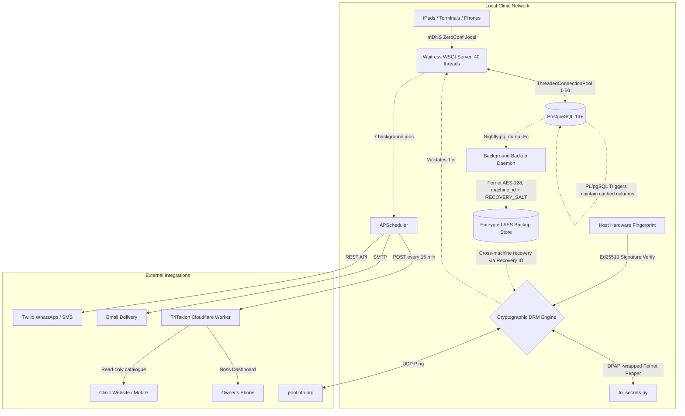

# 🐾 TriVet: Enterprise-Grade Offline-First Veterinary ERP & Autonomous CRM

**[ 🔗 Watch the Clinic Director's Endorsement ](https://youtube.com/shorts/YXOO-PCw0xQ?feature=share)**

---
📌 Executive Summary

TriVet is a proprietary, offline-first Enterprise Resource Planning (ERP) and Shop Management System (SMS) engineered specifically for high-volume veterinary hospitals operating in regions with unstable internet infrastructure. It is not a standard web application — it is a compiled, hardware-bound, on-premise SaaS appliance that turns a single clinic PC into a LAN server, reachable from any tablet, phone, or workstation on the building's Wi-Fi via mDNS.

The system digitizes clinical workflows end-to-end, manages batch-level inventory with FIFO cost accounting, and drives recurring revenue through an autonomous multilingual WhatsApp CRM engine (Arabic / Kurdish / English, with proper RTL handling and Twilio-policy-validated message templates). To enforce a B2B subscription model without any cloud licensing server, the Python/Flask backend is compiled to native C via Nuitka and shipped with a signature-verified Ed25519 DRM engine featuring hardware-UUID binding, NTP-validated temporal tamper detection, per-install DPAPI-wrapped cryptographic secrets, and an anti-debug / anti-reversing guard.

The current generation ships with:

    50+ relational tables and versioned migrations up to V55 (autonomous bootstrapping on first launch)

    12+ clinical & business modules — from SOAP visits to a physical inventory count with blind mode

    Full EN / AR / KU RTL support with runtime language switching, dark mode, and font-size adjuster

    Two commercial tiers — PRO (baseline) and ENTERPRISE (adds the Owner Live Feed and the Message Template Editor)

📈 Live Market Data (15-Month Pilot Study)

Before commercial release, TriVet operated silently in a high-volume clinic in Sulaymaniyah, Iraq to gather unbiased performance data and validate the architecture:

    Processed 5,616 paying transactions flawlessly using the offline-first, dual-currency POS.

    Tracked 6,309,520 IQD in Revenue Leakage — the system autonomously identified 280 "No-Show" appointments, giving clinic ownership complete visibility into evaporated revenue and mitigating future losses via the WhatsApp CRM.

    Eliminated "Room Service" Shrinkage — successfully deployed the Financial Interceptor, autonomously capturing unbilled medical procedures performed on boarded pets and routing them to the correct checkout folio.

Since the pilot completed, the codebase has grown from a single-tier pilot build into a full two-tier commercial product with 30+ additional features (detailed below), including multi-cart POS tabs, physical inventory count reconciliation, care-plan automation, an owner-facing live feed, and a complete message-template editor.
📸 System Interface & Visual Tour

 
<strong>Admin Dashboard View</strong>
 <video src="https://github.com/user-attachments/assets/a29d604b-aa72-4c5d-be82-faf599ddcdad" width="800" autoplay loop muted playsinline></video>

<strong>Clinical Medical Visits and Report Generation</strong>
 <video src="https://github.com/user-attachments/assets/c60e629f-daa7-40e3-957c-7636e09c7ccc" width="800" autoplay loop muted playsinline></video>

<strong>Checkout POS</strong>
 <video src="https://github.com/user-attachments/assets/f01f4eed-327a-4104-90e8-dd8a3034cacb" width="800" autoplay loop muted playsinline></video>

<strong>Inpatient Folio, Hotel Tasks and Services</strong>
  

📊 System Impact & Business Value

    🤖 Autonomous Revenue Engine — 7 APScheduler background jobs dispatch localized WhatsApp/Email recalls, appointment reminders, late-boarding overdue nags, and abandoned-cart alerts. Clinic-authored message bodies are validated against Twilio's messaging policy (variable count ≤5, non-variable word ratio ≥ 2n+1, prohibited-terms blocklist) with full version history and rollback.

    ⚡ 100% Operational Uptime — deployed on the clinic's own hardware, immune to regional ISP outages. ZeroConf (mDNS) broadcasts the app on the LAN. The host PC holds a SetThreadExecutionState sleep-block so the server never naps.

    🔒 Zero-Leakage Financials — dual-currency POS with historical COGS tracking, shift-based cash-drawer reconciliation, per-channel attribution, a 250-IQD rounding rule that records the surcharge to the books (V51 rounding_adjustment column, verified by a DB CHECK constraint), and an Admin-PIN gate for high-discount sales.

    🏥 Hotel Revenue Capture — multi-cage bookings with rate segments so mid-stay transfers don't retroactively reprice; deposits auto-credited to the customer's unified credit pool; recurring care-plan automation; printable A4 owner stay summaries; and a live-feed QR for owners to track their pet.

    📊 Customer Intelligence — loyalty tiers (VIP/Gold/Silver/Bronze), health scores (Champion/Active/At-Risk/Lost/New), next-visit prediction from historical gaps, day/hour purchase patterns, top items, upcoming reminders, and birthday radar — all rendered in a sliding side-panel next to the edit form.

    📦 Physical Inventory Reconciliation — session-based counts with blind mode (non-admins can't see expected quantities until they've entered their own), extendable reason picklists, print-ready worksheets, and one-shot variance application to the underlying batches.

🛠️ Tech Stack & Architecture

    Backend / API: Python 3, Flask, Waitress WSGI (40 threads, 200 connection limit), APScheduler (max_instances=1, coalesce=True, misfire_grace_time=300s)

    Database Engine: PostgreSQL 16+ (current schema dumps are from 18.1) — thick PL/pgSQL architecture with triggers, FOR UPDATE row locks, and pg_advisory_xact_lock for serialized sequences

    Connection Pool: psycopg2.pool.ThreadedConnectionPool (min=1, max=50) with pool-poisoning detection

    Frontend: Server-rendered Jinja2, vanilla JS, SweetAlert2, Chart.js, FontAwesome, Flatpickr. Fully RTL-aware with runtime language switching, dark mode toggle, and A−/A+ font adjuster. No Bootstrap — a single purpose-built master.css.

    Security & Cryptography: Nuitka (source → native C compilation), Ed25519 PEM signatures, Fernet (AES-128-CBC + HMAC-SHA256), werkzeug.security.generate_password_hash (pbkdf2:sha256), HMAC constant-time PIN comparison, per-install DPAPI-wrapped secret (CryptProtectData with machine ID as entropy), RAM-baked templates and migrations

    External APIs: Twilio (WhatsApp / SMS), SMTP, TriTakion Cloudflare Worker (read-only catalogue mirror + Boss Dashboard feed for the clinic owner's phone)

    Build & Deployment: Nuitka (--jobs=0, --python-flag=no-site, --python-flag=no-asserts, --python-flag=no-docstrings, --windows-console-mode=disable), InnoSetup, custom build_ironclad.py with deprecation guards and per-customer watermarking

⚙️ Core Engineering Achievements
1. 🛡️ Asymmetric Cryptographic DRM & Anti-Piracy Engine

To protect intellectual property and enforce a strict SaaS tier model (PRO, ENTERPRISE) in an offline environment, I built a defence-in-depth DRM solution:

    Hardware Fingerprinting — composite hash of the Windows MachineGuid registry value and GetVolumeInformationW volume serial. Permanently binds the software to the physical machine.

    Ed25519 Cryptography — subscription payloads are privately signed via a master private_key.pem. The client verifies the signature mathematically, then Fernet-decrypts the payload to extract machine_id, expiry_date, tier, key_timestamp, and addon flags (WL=1 for white-label).

    Replay Protection — every key embeds a monotonic timestamp; the DB stores last_license_timestamp and rejects any key not strictly newer.

    Per-install DPAPI Pepper — extracted in a separate module (tri_secrets.py) to break a circular import, the Fernet pepper is wrapped by CryptProtectData using the machine ID as entropy. A stolen secrets.bin from another machine is useless.

    NTP Temporal Lockout — the system queries pool.ntp.org to validate the OS clock against an anchor written to %APPDATA% and against the DB's own last_run_timestamp. Winding the clock backward triggers a cryptographic lockdown that can only be lifted by a signed Master Unlock key.

    Live Expiry Enforcement — the license guard runs on every request, not just at boot. A clinic that never reboots still transitions to EXPIRED the exact moment its calendar crosses the expiry date. The master_clinic_cron also re-pings NTP once per 24h of uptime so the offline-grace timer doesn't false-positive.

    Anti-Reverse-Engineering — tamper_guard.py uses IsDebuggerPresent, CheckRemoteDebuggerPresent, a Win32 process enumerator (no cmd.exe spawn — no AV signature), and a wall-clock timing check against single-step execution. Any hit silently os._exit(1)s.

    RAM-Baking — all HTML templates and SQL migrations are Base64-packed into compiled_ui.py / compiled_migrations.py and loaded via a Jinja2 DictLoader, so no plaintext .html or .sql file exists on disk after compilation.

    Per-Customer Watermarking — build_ironclad.py embeds a TRIVET_CUSTOMER_UUID into the binary for forensic identification (this build is UNWATERMARKED).

    Auto-migrating SECRET_KEY — on boot, if SECRET_KEY is missing or set to a known insecure default, the app generates and persists a new one atomically. It logs a warning that stored Twilio/SMTP credentials were encrypted under the old key and need to be re-entered once — trading one-time re-entry for continuous clinic access.

2. 🗄️ "Thick DB" Architecture & Idempotent Migrations

The PostgreSQL schema is engineered to handle heavy business logic, keeping the Python API exceptionally fast and transactional:

    50+ relational tables — the schema is now well beyond the pilot's 25 (batches, credit ledger, supplier payments, rate segments, care plans, count sessions, message templates, sales channels, help videos, idempotency claims, and eleven _v*_backup_* forensic snapshots).

    Autonomous Bootstrapping — setup_db.py connects to Postgres, creates the DB if missing, replays every migration via psql (all migrations packed into RAM as Base64 blobs), and injects admin controls. A boot-time integrity guard in main.py refuses to start the server if compiled_migrations and the live schema_versions table ever diverge — so the code never calls a column that doesn't exist.

    DB Triggers Do Real Work — the Python layer only mutates the underlying ledger tables, never the cached columns. Triggers maintain:

        inventory.quantity ← SUM of active inventory_batches

        customers.account_balance ← SUM of customer_credit_transactions

        supplier_receipts.amount_paid ← SUM of supplier_payments

        appointments auto-cancelled when a pet is marked deceased

    Immutable Audit Log — a PostgreSQL RULE prevents any DELETE from audit_logs. Rows are stamped with user_id, action_type, table_name, record_id, old_data (JSONB), new_data (JSONB), and ip_address.

    Smart Soft-Deletes — partial unique indexes (WHERE is_deleted = FALSE AND email IS NOT NULL) allow customer/pet records to be soft-deleted while freeing up Emails, Phone Numbers, and Microchips for legitimate re-use. Barcodes are mangled with the deleted row's id suffix so historical references stay intact.

    Versioned Forensics — _v36_backup_boarding_intake through _v45_backup_expenses preserve pre-migration state for rollback forensics.

3. 💵 Forensic Accounting & Dual-Currency POS

Engineered for the Middle Eastern market, where purchases are often USD-denominated but billing is IQD:

    Dual-Currency Ledger — inventory purchase cost tracked in USD and IQD with the exchange rate snapshotted on every receipt, so historical COGS never re-prices after a rate change.

    Batch-Level FIFO Costing — inventory_batches is the source of truth. batch_consumption_log is an append-only forensic trail tying every consumed unit to a specific batch, cost, and receipt line.

    250-IQD Rounding to the Books — the POS rounds to the nearest 250 IQD (contract §3). The resulting surcharge lands in rounding_adjustment (V51) so the balance identity subtotal − discount − credit_used + rounding_adjustment = total holds exactly — verified by chk_financial_balance at the DB level. Pre-V51, the surcharge silently vanished from the books, understating net profit.

    Multi-Cart POS Tabs — a cashier can park a sale, start another, and switch back. Persisted to localStorage so a page refresh doesn't lose any cart.

    DB-Backed Idempotency — every checkout is claimed in the processed_transactions table inside the same transaction. A client retry after a crash cannot double-charge — the claim rolls back cleanly with the sale.

    Thread-Safe Receipt Numbering — pg_advisory_xact_lock(hashtext('receipt_number_' || date)) guarantees no two concurrent checkouts compute the same daily sequence number. The prior Python lock released too early and left a race window.

    Admin-PIN Gate — a configurable threshold % with an encrypted Admin PIN, verified server-side in constant time. Enforced at both the UI (JS prompt) and the API (server-side re-check with hmac.compare_digest).

    Per-Channel Attribution — every receipt carries a sales_channel_id; channels are soft-deactivatable so historical receipts never orphan.

    Shift Cash-Drawer Reconciliation — overpaid cash feeds the customer's credit pool (rather than being discarded), while till payouts (supplier "Cash from Till" payments and credit refunds marked from_till) are auto-deducted from the expected closing balance.

4. 🤖 Autonomous CRM & Clinical Automation

    7 APScheduler background jobs (all guarded with max_instances=1 + coalesce=True + a 5-min misfire grace):

        09:30 — appointment reminders (WhatsApp + Email, 24h ahead)

        10:00 — vaccine recalls (3-day catch-up window so a PC asleep over the weekend doesn't skip Friday recalls)

        every 5 min — master cron: backups, housekeeping, No-Show sweep, Twilio monthly quota alert, VACUUM ANALYZE, and 1-year-old audit-log archival to CSV

        every 6 h — hotel care-plan heartbeat (extends the 48-hour task horizon)

        11:00 — overdue boarding WhatsApp nag (3+ days past check-out, one nag per 23h)

        every 15 min — Cloud Catalogue Mirror push to the TriTakion Worker

        every 15 min (offset 30s) — Boss Dashboard inventory push

    Message Template Editor — clinics author custom WhatsApp/Email bodies per language. A validate_template() function enforces Twilio Messaging Policy (variable cap, non-variable word ratio, prohibited-terms blocklist) server-side and rejects anything that would get the clinic's Twilio account suspended. Every change is versioned; any prior version can be restored.

    Multilingual Dispatch — the customer's language_preference (EN/AR/KU) picks the body, and substituted Latin-script values (owner name, pet name) are wrapped in FSI/PDI directional isolates so Arabic and Kurdish messages don't visually invert on the customer's phone.

    Financial Interceptor — procedures entered during a boarding visit bypass the POS "Waiting List" and land on the room tab as boarding_addons, billed through the hotel checkout flow with consumed-cost snapshots that survive to the final receipt.

    Twilio Monthly Hard-Cap — the dispatch functions check communication_logs before every send. At 2,000 messages in a calendar month, the system stops sending rather than silently exceeding the free tier (and blowing the clinic's budget).

5. 🌩️ Automated Disaster Recovery & Data Sovereignty

To mitigate local hardware failure risk (SSD corruption, ransomware, theft):

    AES-Encrypted Backups — a nightly thread runs pg_dump -Fc, then encrypts with Fernet using a key derived from sha256(machine_id || "|" || RECOVERY_SALT). The plaintext dump is deleted inside a finally block — even on encryption failure — so no unencrypted patient data ever sits on disk.

    Cross-Machine Recovery — /api/admin/restore_external_backup accepts an uploaded .aes file and the old machine's 16-char recovery ID. The server tries a candidate-key chain (recovery ID → current machine ID → legacy machine ID) so backups are portable but only to someone holding the vendor-issued recovery ID.

    Cryptographic "Time Machine" — a 1-click rollback in the Admin Dashboard requires a single-use, 15-minute-expiring Vendor Override Key (Ed25519-verified, hardware-bound, with a timezone-aware timestamp comparison). Prevents unauthorized staff from wiping daily sales data.

    Data Sovereignty Export — /api/admin/export_data_sovereignty produces a ZIP of every table as CSV, with a UTF-8 BOM so Excel opens Kurdish/Arabic script natively instead of Windows-1252. Deliberately reachable from the Trial-Ended screen per contract §9.

    Local-First Structured Reports — clinical visits generate human-readable .txt medical reports under <RECORDS_FOLDER>/<PetName_ID>/Visit_<date>_<id>/, which can be synced to Google Drive (or any cloud folder) without a database in the loop.

    Audit-Log Archival — 1-year-old logs are written to _Security_Archives/Audit_Archive_YYYY_MM.csv before the 1-year rolling deletion. The archive is append-only.

6. 🏥 Hotel & Inpatient Subsystem

    Multi-Cage Bookings — boarding_cages junction tracks additional cages (for litters) with per-cage rates. The check-in modal supports adding cages with a live dropdown that excludes already-selected cages.

    Rate Segments — mid-stay transfers create new boarding_rate_segments rows. Billing sums across segments, so past nights never retroactively reprice after a cage change. A clear docstring documents that a transfer moves the primary cage only (secondary cages stay occupied until check-out or edit).

    Recurring Care Plans — DAILY_TIMES / INTERVAL / ONCE frequency types with a 48-hour rolling task generator, a throttled self-heal on lobby load, and a 6-hour heartbeat. One-time tasks can be added ad-hoc on top.

    Owner Live Feed (ENTERPRISE) — an unguessable secrets.token_urlsafe(32) token, a per-boarding kill switch (live_feed_enabled), and a regenerate endpoint that rotates the token and invalidates the old link. The feed is LAN-only by design — any X-Forwarded-For header is rejected as external.

    Deposits — auto-credited to customer_credit_transactions with source='hotel_deposit', immediately applied to outstanding debts, and — critically — refundable through the boarding checkout flow, not via receipt voiding, which the code enforces by blocking hotel_deposit-status receipts from the void endpoint.

    Late Checkout Fees — configurable cutoff hour and % of one night, with a "waive fee" escape at the staff UI (per-checkout opt-out, not a global toggle).

    Bulk Checkout — a multi-select departure list, billed to POS individually per boarding, with clear success/failure counts.

7. 📦 Physical Inventory Count (Blind Mode)

    Session-based reconciliation with header + lines + reasons tables, entirely separate from live stock so an interrupted count can be cancelled without side effects.

    Blind Mode — non-admin counters don't see expected quantities until they enter their count. Admins cannot disable blind mode for non-admins (the server forces is_blind = TRUE when the session role is not Admin).

    Extendable Reason Picklist — soft-deactivate / reactivate / edit, with the same safe-rename pattern as visit_reasons and diagnosis_codes. Race-safe inserts via ON CONFLICT DO NOTHING + re-query.

    One-Shot Variance Application — completing a session generates manual_adjustment movements on the underlying batches, never on the cached column. Quantities reconcile against the current stock (not the snapshot) so the invariant new_qty = old_qty + delta holds.

    Print-Ready Worksheets — a blank reprint for hand-count, an audit copy for completed sessions, with totals, reason text, and signature lines. Fully translated into EN/AR/KU.

8. 📊 Customer Intelligence Panel

    Per-customer analytics — loyalty tier (VIP/Gold/Silver/Bronze by lifetime value and visit count), health score (Champion/Active/At-Risk/Lost/New by gap analysis), next-visit prediction from historical gaps, day-of-week and hour-of-day purchase patterns, top items purchased, recent receipts, category breakdown, upcoming pet reminders, and birthday radar.

    Split-Panel UX — the analytics panel slides out to the right of the edit form with an animated arrow toggle. Collapses gracefully on mobile.

    Debt Alert Banner — outstanding debt shown prominently with a one-click settle.

    Quick Actions — Call / WhatsApp / Book Appointment / Open Visits, all reachable from the analytics panel without losing the edit form.

9. 🌍 Full RTL & Multilingual UI

    Every surface (EN / AR / KU) — from the login screen to the error page to the print-worthy A4 stay summary — carries dictionary entries and direction-aware CSS.

    Font switching — Poppins (EN) / Cairo-Tajawal (AR) / Vazirmatn-Noto Sans Arabic (KU) loaded via a --global-font CSS variable. Poppins has no Arabic glyphs, so without this the browser silently falls through to an arbitrary system default.

    Directional Isolates in Message Templates — Arabic and Kurdish outbound messages wrap substituted Latin-script values in FSI/PDI so the phone's rendering engine keeps the sentence coherent. Kept deliberately in sync with communications.py because divergence silently breaks message rendering on the customer's device.

    Dark Mode + Font-Size Adjuster — persisted to localStorage, applied before first paint to avoid a flash.

10. 🔐 Security Hardening (Phase-by-Phase)

    Login — thread-safe rate limiter (5 attempts / 15-min lockout per IP), werkzeug pbkdf2:sha256 hashing, session token rotation on login/logout/password change.

    Forced Password Change — must_change_password gates every route except /force_password_change, /change_password, /logout, and static assets. API calls receive a machine-readable error_key: errors.password_change_required.

    Fail-Closed Auth — if the DB check in login_required fails (pool exhausted, restore in progress), the middleware returns 503 rather than silently allowing the request through.

    CSRF — every POST/PUT/DELETE requires a session-scoped _csrf_token (with header or form-field transport), extracted before any business logic runs.

    Path Traversal — every send_from_directory call resolves the absolute path and refuses anything outside RECORDS_FOLDER. This is implemented consistently across pets, visits, inventory, feed, hotel tasks, and hotel cleaning photos.

    FK Validation Before Checkout — a pending visit's customer must match the submitted customer_id, or the sale is refused. Prevents billing customer A's pending items to customer B's account.

    Read-Only Mode — an expired paid subscription (not trial) enters Read-Only mode: dashboard remains browsable, but every write operation is 403'd. Auth endpoints are deliberately exempted so a clinic whose session dies can still log back in to view their own data — the read-only guarantee in the contract would otherwise be unreachable.

    Trial vs. Expired Distinction — a lapsed trial goes to a dedicated trial_ended.html screen with data export + uninstall guide, while a lapsed paid subscription goes into Read-Only mode. Two completely different customer experiences for two completely different situations.
---

## 🗺️ System Architecture Topology

--- 

## 📫 Let's Connect

TriVet represents my ability to take a complex business problem and engineer a secure, scalable, and beautiful full-stack solution from scratch.

    Looking to hire a Senior Backend / Full-Stack Engineer? Let's talk.

    Want to deploy TriVet in your clinic? Reach out for a demo.

Email: AlandDiary@outlook.com

> **© 2026 TriTakion. All Rights Reserved.**  
> *The architectural documentation, system diagrams, and media assets presented in this repository are the intellectual property of the author. They may not be copied, reproduced, or used without express permission.*

